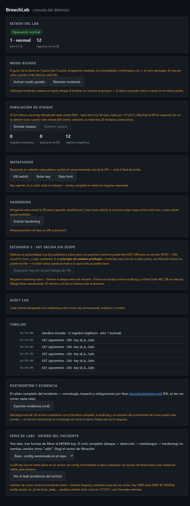
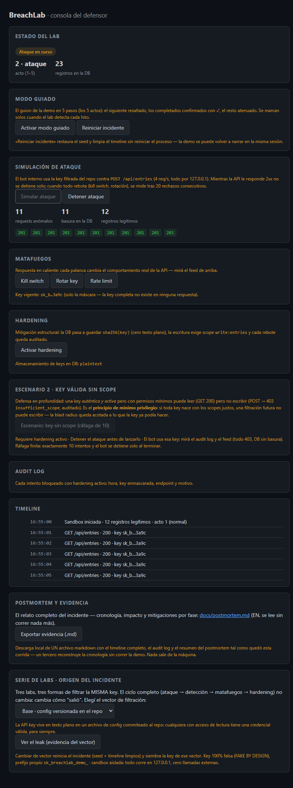
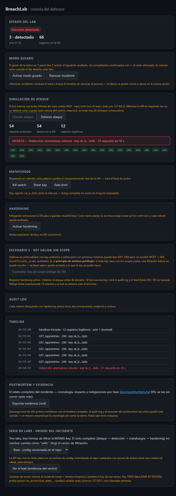
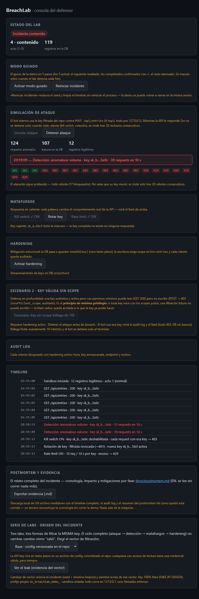
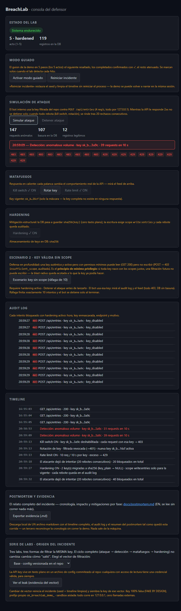

# BreachLab

<!-- BADGES (descomentar tras el primer push — ver docs/PUBLISHING.md):
[](https://github.com/fedesauzzadev/breachlab/actions/workflows/ci.yml)
[](https://github.com/gitleaks/gitleaks-action)
[](LICENSE)
-->

Sandbox interactiva, 100% local, que recrea de punta a punta un incidente clásico de seguridad: una **API key filtrada en un archivo de config versionado**, explotada por un atacante que inunda la base de datos, detectada por monitoreo de anomalías, contenida con kill switch / rotación de key / rate limit, y finalmente endurecida (keys hasheadas, scopes, audit log).

**Por qué existe:** una demostración profesional de respuesta a incidentes. No es un tutorial ni un CTF — es una pieza de porfolio que muestra cómo una credencial filtrada se explota, se detecta, se contiene y se corrige estructuralmente, observada en vivo desde la consola del defensor.

Un solo proceso Node.js, bindeado a `127.0.0.1`. Nada sale de tu máquina.

## Correrlo (2 comandos)

```bash
npm install
npm start
```

Abrí **http://127.0.0.1:3000** — sin configuración, sin variables de entorno, sin build step. Requiere [Node.js ≥ 24](https://nodejs.org) (módulo nativo `node:sqlite`).

## Correrlo con Docker

¿No tenés Node 24 a mano? La misma experiencia, un comando:

```bash
docker compose up --build
```

Abrí **http://127.0.0.1:3000**. Paralo con `Ctrl+C` (o `docker compose down` para desarmarlo del todo).

**Nota de seguridad:** el aislamiento loopback (el server jamás escucha en `0.0.0.0` cuando lo corrés con Node) se preserva **a nivel host mediante el port binding del compose** `"127.0.0.1:3000:3000"` — Docker publica el puerto *solo* en el loopback del host, así que nada es alcanzable desde otras máquinas. Dentro del contenedor el server sí debe bindear `0.0.0.0` (Docker no puede alcanzar el loopback de un contenedor desde afuera — para eso está el `ENV HOST=0.0.0.0` del Dockerfile), y el bot atacante sigue golpeando el `127.0.0.1` interno del contenedor: mismo proceso, mismo relato HTTP real. La carpeta `data/` es efímera por diseño — el lab se re-seedea en cada arranque.

## Qué vas a ver — el incidente en 5 actos

| Acto | La historia |
|------|-------------|
| **1 · Normal** | La API sirve tráfico legítimo; el timeline muestra requests normales. El leak ya está latiendo en una config "versionada" — pulsá "Ver el leak" para encontrarlo. |
| **2 · Ataque** | Un bot golpea la API **con la key filtrada** y llena la DB de basura. |
| **3 · Detección** | El volumen cruza el umbral de anomalía → alerta roja con hora, key enmascarada y motivo. |
| **4 · Contención** | Contraatacás: kill switch, rotación de key, rate limit. El feed muestra respuestas 403/401/429 reales. |
| **5 · Hardening** | Las keys pasan a hashes sha256, se exigen scopes, cada intento bloqueado queda en el audit log. El re-ataque rebota. |

Manejas toda la respuesta desde el panel; los 401/403/429 que ves son respuestas HTTP reales producidas por los middlewares — no efectos de UI.

## Demo — el incidente en cinco capturas

Capturas reales de la consola del defensor, el mismo flujo que ves con `npm start`:

**Acto 1 · Normal** — la API sirve tráfico legítimo. La bomba ya está plantada: la key está filtrada en una config "versionada".


**Acto 2 · Ataque** — el bot interno dispara con la key filtrada; los requests anómalos y la basura en DB crecen en vivo.


**Acto 3 · Detección** — el volumen cruza el umbral: alerta critical con hora, key enmascarada y motivo.


**Acto 4 · Contención** — kill switch + rotación + rate limit. El feed muestra 403/401/429 reales; el atacante se rinde tras 20 rebotes consecutivos.


**Acto 5 · Hardening** — keys como hashes sha256, scopes exigidos, cada intento bloqueado auditado. El re-ataque rebota, cero basura nueva.


**Nuevo en v0.3.0:** BreachLab es ahora una **serie de labs** — elegí cómo se filtró la
key (config versionada · log de errores del server expuesto · bundle del frontend
legacy) y rejugá el mismo incidente en 5 actos sobre ese vector, cada uno con su
evidencia de leak y su narración. Después **exportá la evidencia**: un archivo markdown
con el timeline completo, el audit log y el resumen del postmortem, generado
server-side y descargado localmente — un tercero reconstruye el incidente sin correr
nada. **v0.2.0:** modo guiado con hitos automáticos (la forma recomendada de narrar la
demo frente a reclutadores), reinicio del incidente al instante y un segundo escenario
que cuenta la historia del mínimo privilegio.

**Leé el relato completo después de la demo: [postmortem del incidente](docs/postmortem.md)** (EN) — cronología, impacto, causa raíz, respuesta rápida y mitigaciones estructurales, redactado como reporte profesional.

## Arquitectura

Un proceso Node, ~950 líneas de producto, **una sola dependencia de runtime (Express)**, sin build.

```
┌─ NAVEGADOR ──────────────────────────────────────────────────────┐
│ public/index.html + panel.js — UI vanilla, polling 1s, sin build │
└──────────────┬───────────────────────────────────────────────────┘
               │ fetch loopback
┌──────────────▼───────────── EXPRESS (server.js) ─────────────────┐
│  API VÍCTIMA (entries.js)       CONSOLA DEFENSOR (labroutes.js)  │
│  GET/POST /api/entries          /api/lab/state · timeline        │
│        │                        /attack · firewall/*             │
│        ▼                        /hardening · audit · export      │
│  [ratelimit.js] → [apikey.js]   /scenarios · reset               │
│   10 req/10s por key   ¿key? ¿scope? detector anomalía (solo POST)│
│        │                                │                        │
│        ▼                                ▼                        │
│  ┌─ node:sqlite (nativo) ── lab.js = CORAZÓN (máq. de estados) ─┐ │
│  │ entries · events · audit · api_keys                         │ │
│  └─────────────────────────────────────────────────────────────┘ │
│  BOT ATACANTE (attacker.js) — vive DENTRO del proceso:           │
│  HTTP real contra 127.0.0.1 → los 401/403/429 del feed son       │
│  respuestas genuinas del middleware, no efectos de UI. Se rinde  │
│  tras 20 rebotes consecutivos.                                   │
│  ESCENARIOS (scenarios.js) — 3 vectores de leak + artefactos     │
│  falsos (repo-sim/config.json, public/leak/*)                    │
└──────────────────────────────────────────────────────────────────┘
```

**Por qué tiene esta forma:**

1. **`lab.js` es el corazón** (~200 líneas): dueño de la DB, del seed, de la máquina de estados de los 5 actos, de los flags (killswitch/rotación/hardening), del contador `epoch` (protección anti-race del reset) y de las operaciones de negocio. Todo pasa por él — los demás módulos son superficies.
2. **Dos APIs con piel distinta**: `entries.js` es la API que sufre el ataque (validación estricta en frontera: title 1–80, body 1–280); `labroutes.js` es tu consola de defensor (sin key — solo existe en loopback).
3. **Middlewares encadenados** `rateLimit → apikey → handler`: ese orden es una decisión documentada — throttlear *antes* de autenticar bajo flood. `apikey.js` tiene dos modos: vulnerable (compara texto plano — la mala práctica que la demo denuncia) y hardened (sha256 + scope).
4. **La simulación ataca de verdad**: el bot dispara HTTP real contra el propio loopback del server. Por eso el feed muestra códigos HTTP reales — la diferencia entre una demo y un mock.
5. **Panel sin estado**: la UI no guarda nada — polla `/api/lab/state` cada segundo y pinta lo que el server dice. Fuente única de verdad: la DB + `lab.js`.

| Composición | |
|---|---|
| Código producto | 9 archivos · ~950 líneas (incl. panel) |
| Tests | 11 suites · 60 tests · ~98% coverage |
| Duplicación | <1% en `src/`, 4.2% en tests (jscpd) |
| Dependencias | 1 de runtime (Express) · SQLite nativo vía `node:sqlite` |

## Nota de seguridad (leé esto)

- **Todas las keys de este repo son falsas.** Usan el prefijo `sk_breachlab_demo_` y son *FAKE BY DESIGN* — jamás hay un secret real de terceros. El repo trae un gate de secrets (`npm run scan:secrets`) que debe dar **0 findings**.
- **Solo loopback.** El server bindea exclusivamente `127.0.0.1` y hace cero llamadas a hosts externos. Lo "vulnerable por diseño" aplica *solo dentro de la sandbox*.

## Stack técnico (deliberadamente mínimo)

| Capa | Elección |
|---|---|
| Runtime | Node.js ≥ 24 — `node:sqlite` nativo, cero compilación nativa |
| HTTP | **Express — la única dependencia de runtime** |
| UI | HTML/CSS/JS vanilla servido por Express — cero build step |
| Tests | `node:test` + `fetch` nativo — cero devDependencies |
| CI | GitHub Actions: tests + cobertura + gitleaks en cada push/PR |

## Desarrollo

```bash
npm ci                 # install reproducible desde package-lock.json
npm test               # suite: unit + integración HTTP en loopback
npm run test:coverage  # reporte de cobertura de líneas de src/
npm run scan:secrets   # gitleaks — debe dar 0 findings
```

## Troubleshooting

| Problema | Solución |
|---|---|
| Error al arrancar / falta `node:sqlite` | Necesitás Node ≥ 24. Verificá con `node --version`. |
| Puerto 3000 ocupado | `PORT=3001 npm start` (Windows PowerShell: `$env:PORT=3001; npm start`). |

## Licencia

[MIT](LICENSE) — libre de usar, estudiar y forkear.

---

[Read this in English](README.md)
